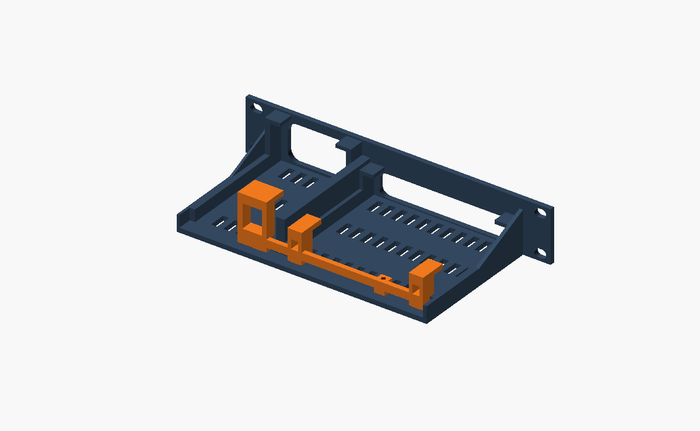

# Flex Mini 2.5G + PoE injector mount (1U)

A one-piece 1U mount that holds a UniFi Flex Mini 2.5G switch and a U-PoE-AT injector side by side. Each sits behind a rounded bezel window, so its front ports are reachable. A slotted retaining frame clamps both devices from behind with two flush M3 screws. This is the V4 design: it prints as two parts, and the rack view uses it at U11.

| File | Qty | Size (mm) |
|---|---|---|
| [`01-main-mount-PRINT-1.stl`](01-main-mount-PRINT-1.stl) | 1 | 254 × 44 × 116 |
| [`02-retaining-frame-PRINT-1.stl`](02-retaining-frame-PRINT-1.stl) | 1 | 154.55 × 42.4 × 22.9 |

Sources: [`rack-mount-v4.scad`](rack-mount-v4.scad) is the main mount and [`retainer-frame-v4.scad`](retainer-frame-v4.scad) is the frame. [`assembly-check.scad`](assembly-check.scad) puts the two together for checking. Full print and assembly notes, including device positions, clearances and hardware, are in [PRINT-AND-ASSEMBLY.md](PRINT-AND-ASSEMBLY.md).

This was copied from the original working folder (`~/Documents/ChatGPT/10 in rack/v4-slot-retainer`), so the rack view no longer depends on that folder.
