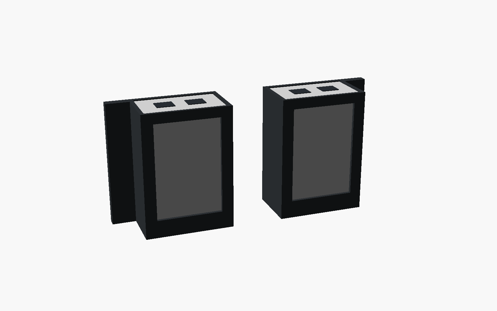
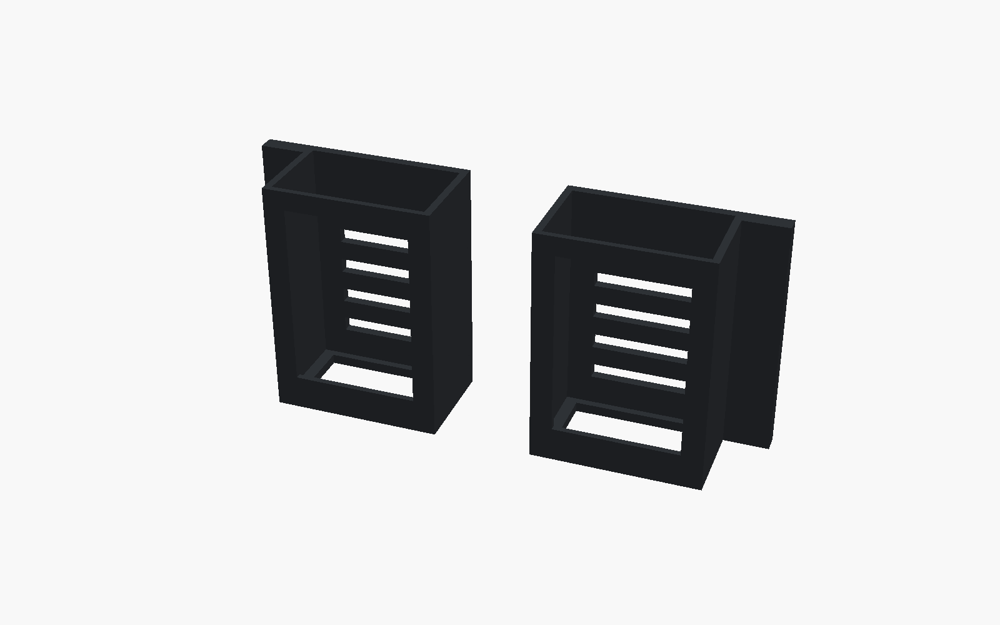

# Injector holster for the rear rails

Holds a U-PoE-AT PoE injector standing on end just outside the back of the rack, on a rear rail, either way up: ports up with the power socket down, or the reverse. A flat plate bolts to the back (outside) face of the rail with two rack screws, 1U apart, so nothing takes up space inside the rack. The injector slides in from the top. Side walls and front lips keep it from falling forward or sideways, and a shelf carries it on 5 mm ledges. The inside corners are rounded (7 mm) to follow the injector's rounded edges, and a 4 mm chamfer where the shelf meets the walls cups its rounded bottom edges, so it sits snug with no square corners to knock against. The window in the shelf is almost full width, about 53 × 30 mm, so the power plug or both RJ45 plugs can pass through it. The left and right versions are mirror images, so the two sides of the rack can match.

## Parts

| File | Size (mm) | Notes |
|---|---|---|
| [`stl/holster_right.stl`](stl/holster_right.stl) | 88 × 43 × 98 | For the right rear rail (seen from the front). |
| [`stl/holster_left.stl`](stl/holster_left.stl) | 88 × 43 × 98 | Mirror image, for the left rear rail. |

Both print standing on the shelf end, as they are in the STL, with no supports. Only the short lip across the top front bridges.

Hardware: 2 rack screws per holster. The slots are 5.2 mm wide, which fits 10-32 or M5, and the rack kit's 10-32 screws should work. For M6, set `screw_d = 6.6`. The slots are 6 mm long vertically, so the holster can line up with any pair of holes 1U apart.

## Fit

- **Injector:** 62 × 35 × 93 mm with 0.6 mm of play ([datasheet](https://dl.ui.com/ds/u-poe-at_ds.pdf)). The UACC-PoE+-2.5G is the same size.
- **Footprint:** each holster sticks out 43 mm behind the rack and reaches about 79 mm in from the rail hole, toward the middle. It takes no room inside the rack, so it can go at any height, even beside the Mac shelf. The left holster goes on the left rail and the right one on the right, as seen from the front of the rack.
- **Rear rail:** not measured yet. The plate assumes the rear rails' holes go right through, so a screw can go in from the back. If they're tapped, the rack kit's 10-32 screws thread straight in.

## Editing

Everything is in [`injector_holster.scad`](injector_holster.scad). The most useful settings are `clear`, `screw_d`, `hole_gap_u`, `lip` and `power_win`. Run `./build.sh` to rebuild.
