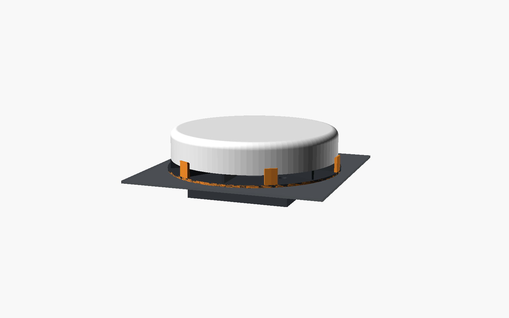
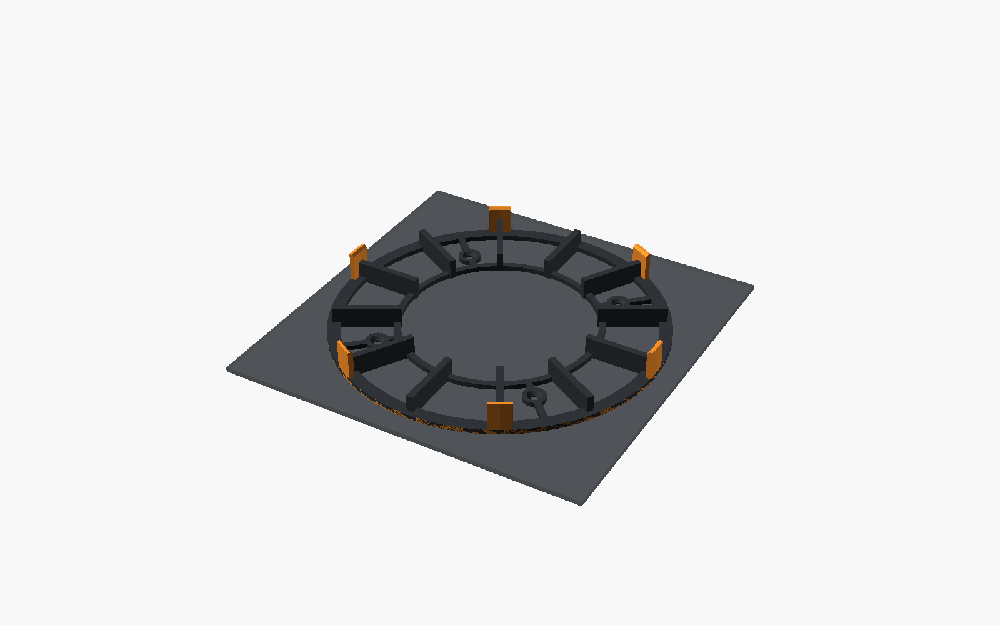

# U6 Pro low riser

An open ring that sits on the DeskPi RackMate T2's acrylic top cover and holds the UniFi U6 Pro 10 mm above it. A 120 mm fan goes **under** the cover, inside the rack, and blows up through the cover's vents. The same four M4 bolts go down through the ring, the acrylic and the fan's corner holes, so one set of bolts holds both. Air comes up through the open middle of the ring, hits the back of the AP, and leaves sideways between the ribs and tabs.

The top of the AP sits 48 mm above the cover.

The part that touches the cover is an open web, not a solid plate: an outer ring under the tabs, a thin inner ring, the 4 mm ribs and four bolt pads with short spokes. Nearly all of the cover's vents under the ring stay uncovered, so they breathe as well as the open middle. It's meant for ABS (or ASA), which is stiff enough for a web this light. Set `solid_plate = true` to go back to the solid ring.

## Parts

| File | Qty | Size (mm) | Notes |
|---|---|---|---|
| [`stl/riser.stl`](stl/riser.stl) | 1 | Ø205 × 21 | Prints flat with the ribs and tabs up. No supports. |

Hardware:
- 4 × M4 countersunk bolts, about 40 mm long, and 4 × M4 nuts. Use a nylon-insert nut under the fan so vibration doesn't loosen it.
- A 120 × 25 mm fan with the standard 105 mm hole spacing, such as a 5 V USB Noctua. Use a 120 × 15 mm slim fan if the space under the cover turns out to be tight. Set `fan_thick = 15` and use about 30 mm bolts.

## Fitting it

1. Find the middle of the top cover. Mark four holes on a 105 mm square there and drill them 4.5 mm. You can skip drilling if the cover's vent slots happen to line up. Drill acrylic slowly, with a sharp bit and something flat underneath, or it can crack.
2. Hold the fan under the cover, **airflow arrow pointing up**, and the riser on top with its open middle over the fan.
3. Put the bolts down through the riser, the cover and the fan, and tighten the nuts underneath. The heads sit flush in the ring, under the AP.
4. Bring the PoE cable up the front of the rack and in under the AP from the front, between two ribs. The lanes between ribs are about 50 mm wide at the edge, so the cable lies flat in the 10 mm gap and plugs into the AP's port.
5. Set the AP on the ribs, between the orange tabs.

## Fit and dimensions

- **U6 Pro:** Ø197 × 35 mm ([Ubiquiti spec](https://techspecs.ui.com/unifi/wifi/u6-pro)). The tabs sit on a 198.6 mm circle, so the AP has 0.8 mm of play all round.
- **Riser:** 205 mm across. That leaves 17 mm each side between the rack's top handles, which measure 239 mm apart.
- **Air gap under the AP:** 10 mm (`air_gap`). The open middle is 118 mm across, matching the fan.
- **Space under the cover (unconfirmed):** assumed to be enough for the fan, about 28 mm for a 25 mm fan. The rack's spec image shows a 33 mm band above the rails, but this hasn't been measured on the real rack.
- **Not confirmed:** where the U6 Pro's Ethernet port sits on its back. The 10 mm gap fits the cable, but a plug with a bulky boot may be tight.
- **Injector:** goes in the rack for now. It isn't part of this design.

## Printing

Same material advice as the shelf: ABS or ASA (PETG works too). Use 0.2 mm layers, 3–4 walls and 15–20% infill. The design is two colours to match the rack: a dark ring with orange tabs. On a single-colour printer, print it all dark, or swap filament at the height where the ribs end (13 mm) so the tab tops come out orange.

## Editing

Everything is in [`u6pro_riser.scad`](u6pro_riser.scad). The most useful settings are `air_gap`, `fan_thick`, `tab_n`/`tab_w`/`tab_up`, `ap_clear` and `cable_gap_a`, which can leave one rib out if you ever want a wider cable lane (-1 = none). Run `./build.sh` to rebuild the STL and images.

The earlier designs, the round fan pedestal and the injector pod, are in the git history.
