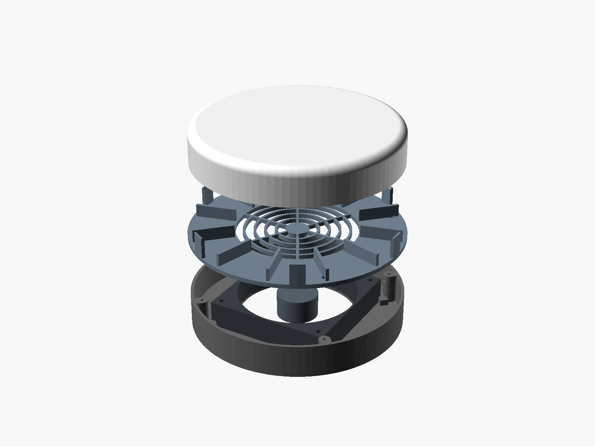
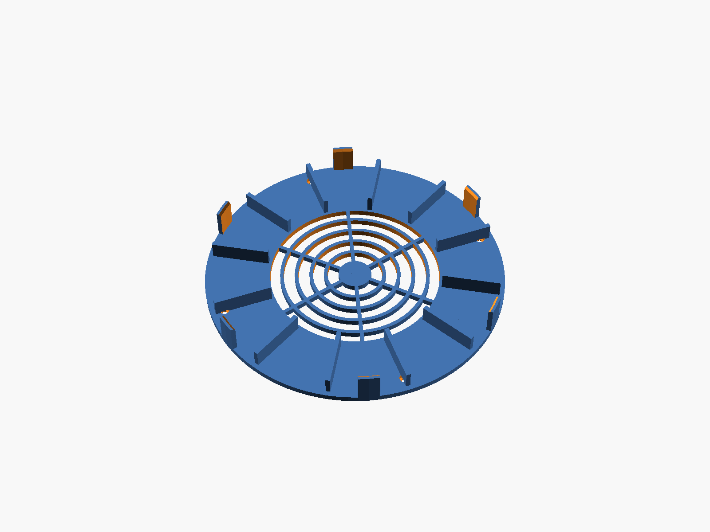
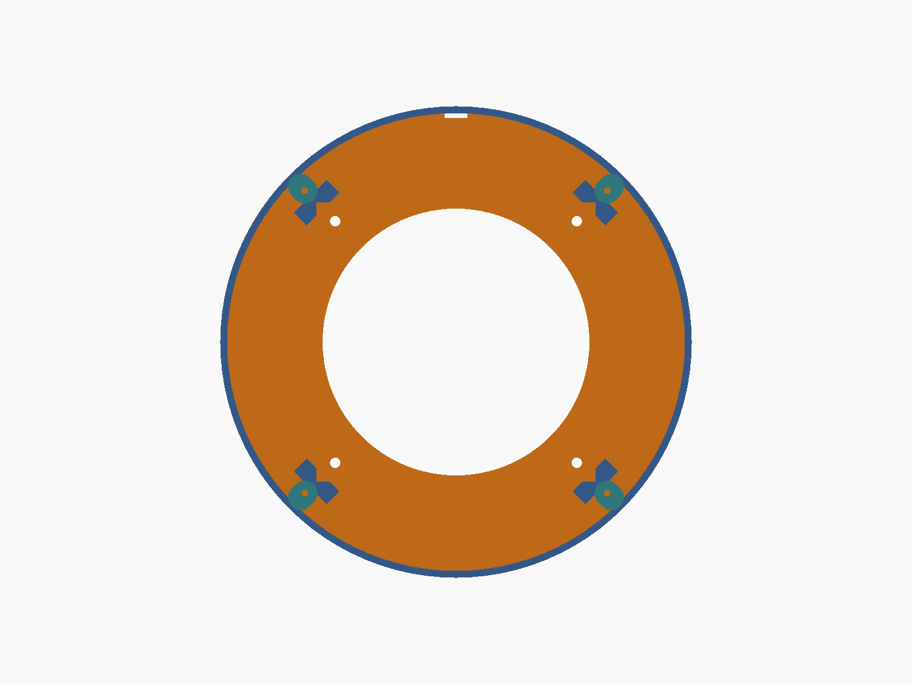

# U6 Pro fan pedestal

A round pedestal that sits on top of the DeskPi RackMate T2, on its vented acrylic top cover. A 120 mm fan inside pulls warm air up out of the rack and blows it across the back of the UniFi U6 Pro, which sits on ribs 12 mm above the deck. The air leaves sideways through the gaps between the six tabs that hold the AP in place.

The PoE injector isn't in the pedestal. It goes somewhere inside the rack, and the PoE cable comes up the back and in under the AP.

## Parts

| File | Qty | Size (mm) | Notes |
|---|---|---|---|
| [`stl/base.stl`](stl/base.stl) | 1 | Ø205 × 32 | Prints floor-down. No supports. |
| [`stl/deck.stl`](stl/deck.stl) | 1 | Ø205 × 24 | Prints flat with the ribs and tabs up. No supports. |
| [`stl/fit_check.stl`](stl/fit_check.stl) | 1 | Ø205 × 24 | Optional. The deck's outer ring with the AP tabs, plus the floor with the fan guides and screw holes. Print it first to check the fit. |

**Hardware**
- **Deck:** 4 × M3×10 screws and 4 × M3 nuts.
- **Fan:** 4 × M4×35 countersunk screws and 4 × M4 nuts (use M4×25 for a 15 mm slim fan).
- **Fan:** a 120 mm × 25 mm fan with the standard 105 mm hole spacing. A 5 V USB fan, such as a 5 V Noctua 120 mm, can run off any USB port. Its lead leaves through a small notch at the back of the base.
- **Feet (optional):** stick-on rubber feet. The spare anti-slip pads from the rack kit work, and there are 21 mm recesses for them under the base.

## How it goes together

1. Slide an M3 nut into the side slot of each of the four posts in the base. The slots open towards the middle.
2. Set the fan in the base between the corner guides, **airflow arrow pointing up** (the label side faces down). Bolt it down with the M4 screws from underneath. The heads sit flush, so the base stays flat.
3. Run the fan lead out through the notch at the back.
4. Screw the deck down.
5. Run the PoE cable in from the back, between the two rear tabs. It lies under the AP in the 12 mm gap and plugs into the AP's port.
6. Set the AP on the ribs, between the tabs.

## Fit and dimensions

- **U6 Pro:** Ø197 × 35 mm ([Ubiquiti spec](https://techspecs.ui.com/unifi/wifi/u6-pro)). The tabs sit on a 198.6 mm circle, so there's 0.8 mm of play all round. They reach 8 mm up the side of the AP.
- **Air path:**
  - Intake: a 116 mm opening in the floor.
  - Deck: a 116 mm finger grille over the fan.
  - Exit: about 6,500 mm² round the AP, close to the fan's own open area.
- **Size:** the pedestal is 205 mm across and 32 mm tall. The top of the AP ends up 83 mm above the rack top.
- **Handles:** the measured gap between the rack's two top handles is 239 mm (`handle_gap`). That leaves 17 mm of space on each side of the pedestal.
- **Not confirmed:** where the U6 Pro's Ethernet port sits on its back. The cable path assumes it's near the middle, where the ceiling mount puts it. The 12 mm gap leaves room for the cable but is tight for a plug with a bulky boot.
- **Not locked:** the AP sits between the tabs under its own weight (580 g). It isn't locked in.

## Printing

Same material advice as the shelf: ABS or ASA (PETG is fine too). Use 0.2 mm layers, 3–4 walls and 15–20% infill. Each part is 205 mm across, so any bed of 210 mm or more works.

## Editing

Everything is in [`u6pro_top_mount.scad`](u6pro_top_mount.scad). These are the settings you're most likely to change:

| Setting | What it does |
|---|---|
| `air_gap` | Space under the AP |
| `tab_n`, `tab_w`, `tab_up` | Number, width and height of the AP tabs |
| `fan_thick` | Fan thickness: 25 mm, or 15 mm for a slim fan |
| `intake_d` | Size of the floor opening under the fan |
| `grille_d`, `grille_pitch` | Size and ring spacing of the fan grille |
| `ap_clear` | Play around the AP |

Run `./build.sh` to rebuild the STLs and images.

## 3D viewer

[`viewer.html`](viewer.html) is a self-contained 3D viewer you can open in a browser, with explode, cut-away and airflow views. It embeds the base and deck STLs. After changing the model, rebuild it from `viewer_template.html`: replace `__BASE__` and `__DECK__` with the base64 of a binary STL of each part.
