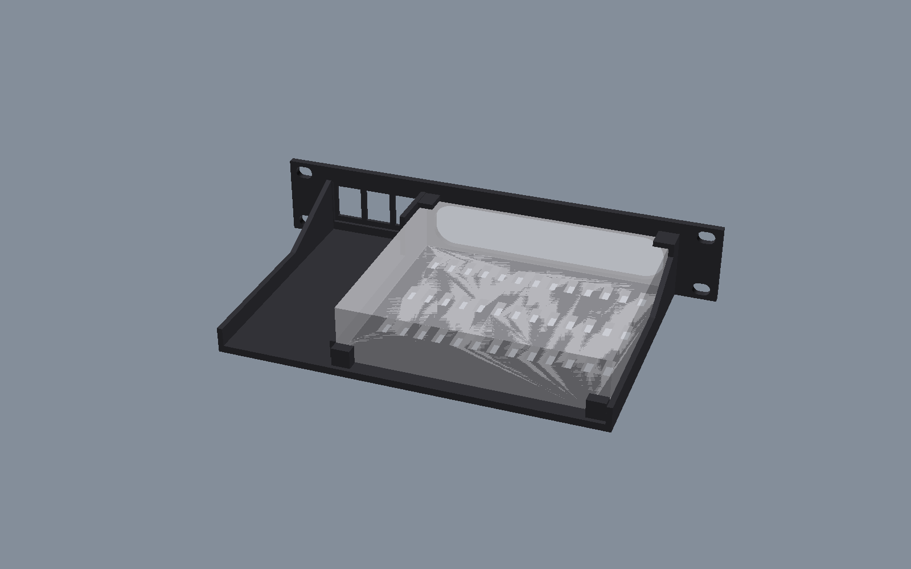
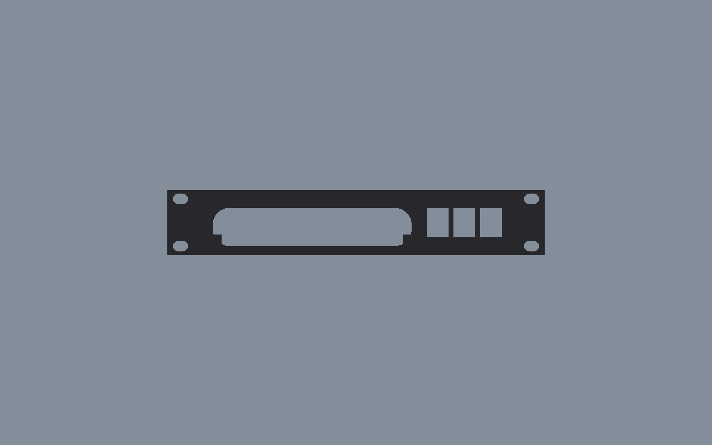

# UCG Ultra mount (1U)

A printable 1U mount for the UniFi Cloud Gateway Ultra, made to match the [Flex Mini mount](../flex_mini_mount/). It uses the same faceplate, ear slots, rounded bezel window, front hoods and vented tray, so it can be printed in the same black ABS as the other parts. It replaces the bought Blazin3D mount.

## Parts

| File | Qty | Size (mm) | Notes |
|---|---|---|---|
| [`01-ucg-ultra-mount-PRINT-1.stl`](01-ucg-ultra-mount-PRINT-1.stl) | 1 | 254 × 44 × 141 | Prints front-down, with no supports, like the Flex Mini mount. On a 256 mm bed that leaves 1 mm on each side. |
| [`fit-coupon-front-20mm.stl`](fit-coupon-front-20mm.stl) | 1 | 254 × 44 × 20 | Optional. The front 20 mm only, to check the bezel, the hoods, the keystones and your rack's hole spacing first. |

Hardware: 3 standard snap-in keystone jacks (or blanks), and the usual rack screws. The faceplate is thinned to 2 mm around each keystone cut-out (14.9 × 19.4 mm) so the jacks clip in.

## How it holds the gateway

- **Front:** the bezel overlaps the gateway's front by 4 mm at the sides and 2 mm top and bottom. Its 0.96" status screen stays visible in the middle.
- **Top front corners:** two hoods, 8 mm wide, cover them with 0.6 mm of play, the same as on the Flex Mini mount.
- **Sides:** guides with 0.6 mm of play.
- **Back:** low stops at the two back corners keep the gateway from sliding back. They leave its rear ports clear.
- **Strap (optional):** there are zip-tie slots either side, near the back, for a tie over the top.

To fit it, tip the gateway's front under the hoods, push it against the bezel, then lower the back onto the tray.

## Fit

- **Gateway:** 141.8 × 127.6 × 30 mm ([Ubiquiti spec](https://techspecs.ui.com/unifi/cloud-gateways/ucg-ultra)). The rounding of its front edges is estimated from photos, so print the fit coupon first.
- **Rack holes:** the faceplate and rack holes are identical to the Flex Mini mount's: 236.5 mm hole spacing with 10 × 7 mm slots.
- **Keystone depth:** the keystones need about 30 mm of depth behind the faceplate. There's a 34 mm clear bay behind them.

Edit [`ucg-ultra-mount.scad`](ucg-ultra-mount.scad) and run `./build.sh` to rebuild.
